# Free wallpapers for Lumen

25 original illustrated wallpapers and 5 live loops for [Lumen](https://github.com/notgamermx/lumen-new-tab). All files are **1920 × 1080** and free to use, modify, and share under [CC0](LICENSE).

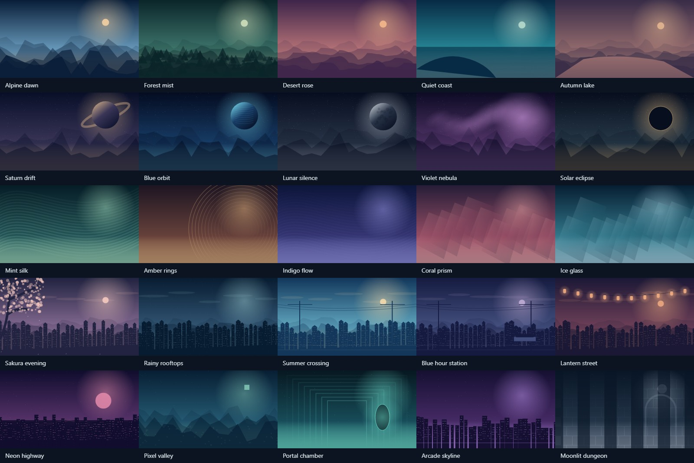

## Use a wallpaper

1. Choose a PNG or live WebM below. Open the file and save it to your device. On GitHub, use the download button on the file page, or **Save image as** for an opened image.
2. Open a Lumen new tab, then **Customize → Wallpaper**.
3. Choose your downloaded file or drop it into the upload area.

PNG files are still images. WebM files are silent 6-second animated loops. Lumen repeats them automatically. These are original vector illustrations, including anime-inspired scenery and gaming-inspired designs; no franchise characters or third-party screenshots are included.

[Download the entire collection as a ZIP](https://github.com/notgamermx/wallpaper/archive/refs/heads/main.zip)

## Live wallpapers

| Preview                                          | Download                                                                       |
| ------------------------------------------------ | ------------------------------------------------------------------------------ |
| 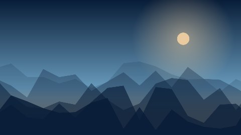       | **Alpine dawn** · [WebM](./live/alpine-dawn.webm) · Nature                     |
| 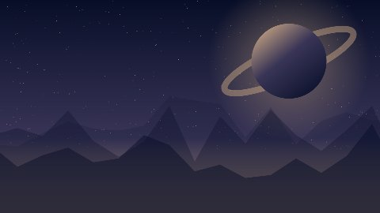     | **Saturn drift** · [WebM](./live/saturn-drift.webm) · Space                    |
|            | **Mint silk** · [WebM](./live/mint-silk.webm) · Abstract                       |
| 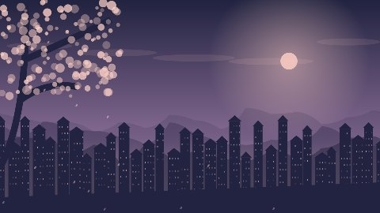 | **Sakura evening** · [WebM](./live/sakura-evening.webm) · Anime-style scenery  |
| 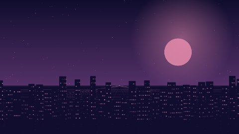     | **Neon highway** · [WebM](./live/neon-highway.webm) · Gaming-style backgrounds |

## Nature

| Preview                                    | Download                                                                                          |
| ------------------------------------------ | ------------------------------------------------------------------------------------------------- |
|  | **Alpine dawn** · [PNG](./wallpapers/alpine-dawn.png) · [Editable SVG](./sources/alpine-dawn.svg) |
| 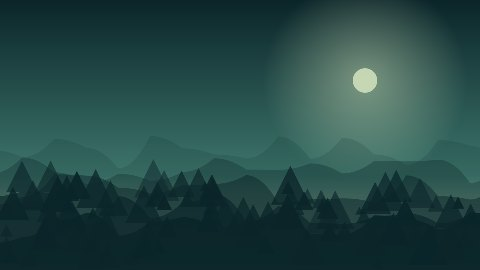 | **Forest mist** · [PNG](./wallpapers/forest-mist.png) · [Editable SVG](./sources/forest-mist.svg) |
| 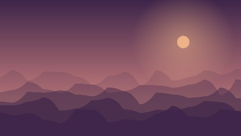 | **Desert rose** · [PNG](./wallpapers/desert-rose.png) · [Editable SVG](./sources/desert-rose.svg) |
| 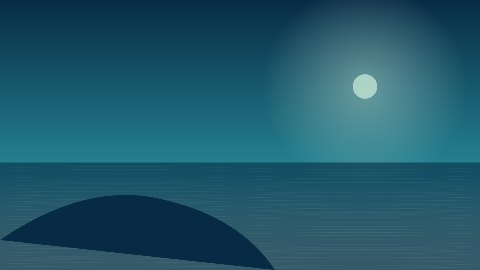 | **Quiet coast** · [PNG](./wallpapers/quiet-coast.png) · [Editable SVG](./sources/quiet-coast.svg) |
| 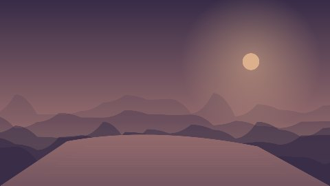 | **Autumn lake** · [PNG](./wallpapers/autumn-lake.png) · [Editable SVG](./sources/autumn-lake.svg) |

## Space

| Preview                                        | Download                                                                                                |
| ---------------------------------------------- | ------------------------------------------------------------------------------------------------------- |
|    | **Saturn drift** · [PNG](./wallpapers/saturn-drift.png) · [Editable SVG](./sources/saturn-drift.svg)    |
| 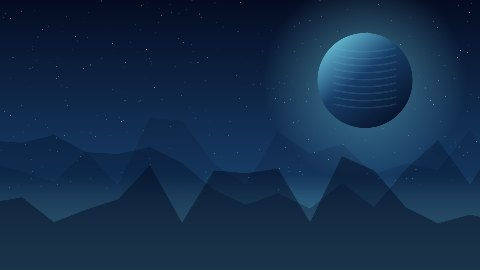       | **Blue orbit** · [PNG](./wallpapers/blue-orbit.png) · [Editable SVG](./sources/blue-orbit.svg)          |
| 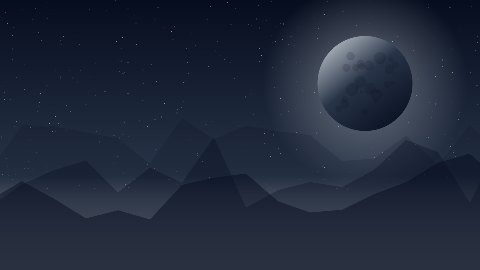 | **Lunar silence** · [PNG](./wallpapers/lunar-silence.png) · [Editable SVG](./sources/lunar-silence.svg) |
| 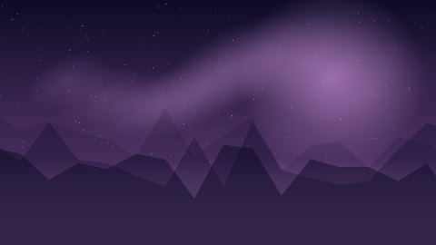 | **Violet nebula** · [PNG](./wallpapers/violet-nebula.png) · [Editable SVG](./sources/violet-nebula.svg) |
| 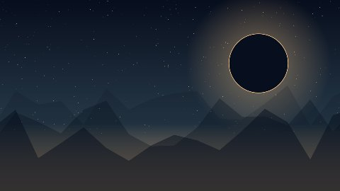 | **Solar eclipse** · [PNG](./wallpapers/solar-eclipse.png) · [Editable SVG](./sources/solar-eclipse.svg) |

## Abstract

| Preview                                    | Download                                                                                          |
| ------------------------------------------ | ------------------------------------------------------------------------------------------------- |
|      | **Mint silk** · [PNG](./wallpapers/mint-silk.png) · [Editable SVG](./sources/mint-silk.svg)       |
|  | **Amber rings** · [PNG](./wallpapers/amber-rings.png) · [Editable SVG](./sources/amber-rings.svg) |
|  | **Indigo flow** · [PNG](./wallpapers/indigo-flow.png) · [Editable SVG](./sources/indigo-flow.svg) |
|  | **Coral prism** · [PNG](./wallpapers/coral-prism.png) · [Editable SVG](./sources/coral-prism.svg) |
|      | **Ice glass** · [PNG](./wallpapers/ice-glass.png) · [Editable SVG](./sources/ice-glass.svg)       |

## Anime-style scenery

| Preview                                                | Download                                                                                                            |
| ------------------------------------------------------ | ------------------------------------------------------------------------------------------------------------------- |
|        | **Sakura evening** · [PNG](./wallpapers/sakura-evening.png) · [Editable SVG](./sources/sakura-evening.svg)          |
| 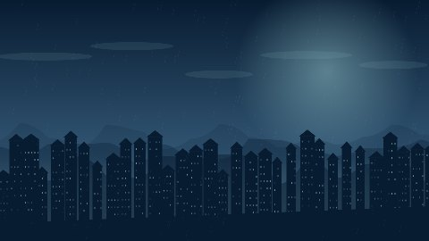       | **Rainy rooftops** · [PNG](./wallpapers/rainy-rooftops.png) · [Editable SVG](./sources/rainy-rooftops.svg)          |
| 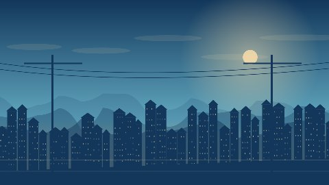     | **Summer crossing** · [PNG](./wallpapers/summer-crossing.png) · [Editable SVG](./sources/summer-crossing.svg)       |
| 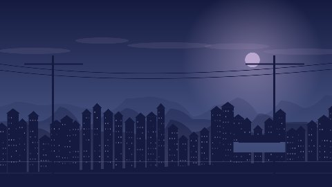 | **Blue hour station** · [PNG](./wallpapers/blue-hour-station.png) · [Editable SVG](./sources/blue-hour-station.svg) |
| 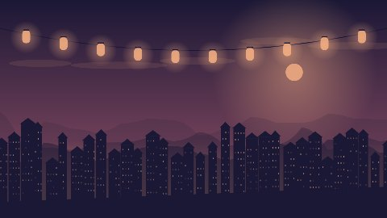       | **Lantern street** · [PNG](./wallpapers/lantern-street.png) · [Editable SVG](./sources/lantern-street.svg)          |

## Gaming-style backgrounds

| Preview                                            | Download                                                                                                      |
| -------------------------------------------------- | ------------------------------------------------------------------------------------------------------------- |
|        | **Neon highway** · [PNG](./wallpapers/neon-highway.png) · [Editable SVG](./sources/neon-highway.svg)          |
| 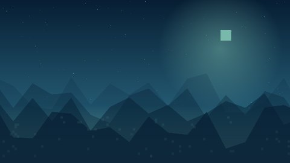       | **Pixel valley** · [PNG](./wallpapers/pixel-valley.png) · [Editable SVG](./sources/pixel-valley.svg)          |
| 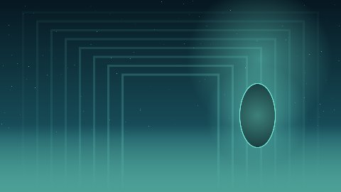   | **Portal chamber** · [PNG](./wallpapers/portal-chamber.png) · [Editable SVG](./sources/portal-chamber.svg)    |
| 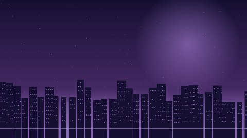   | **Arcade skyline** · [PNG](./wallpapers/arcade-skyline.png) · [Editable SVG](./sources/arcade-skyline.svg)    |
| 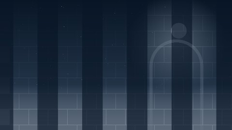 | **Moonlit dungeon** · [PNG](./wallpapers/moonlit-dungeon.png) · [Editable SVG](./sources/moonlit-dungeon.svg) |

## Source and license

The artwork is drawn locally from vector shapes. SVG sources are included in `sources/`; `catalog.json` lists every export, category, resolution, and license. Artwork is dedicated under [CC0](LICENSE), and the export scripts use the [MIT license](scripts/LICENSE). Attribution is optional.

To recreate the collection with Node.js 22 or newer and Microsoft Edge on Windows:

```sh
npm run generate
npm run render
node scripts/readme.mjs
```

Set `BROWSER_PATH` to use another Chromium browser. The renderer uses an isolated browser profile and checks that every image and video decodes at full-HD resolution. Generated browser profiles stay in the ignored `.cache/` folder.
